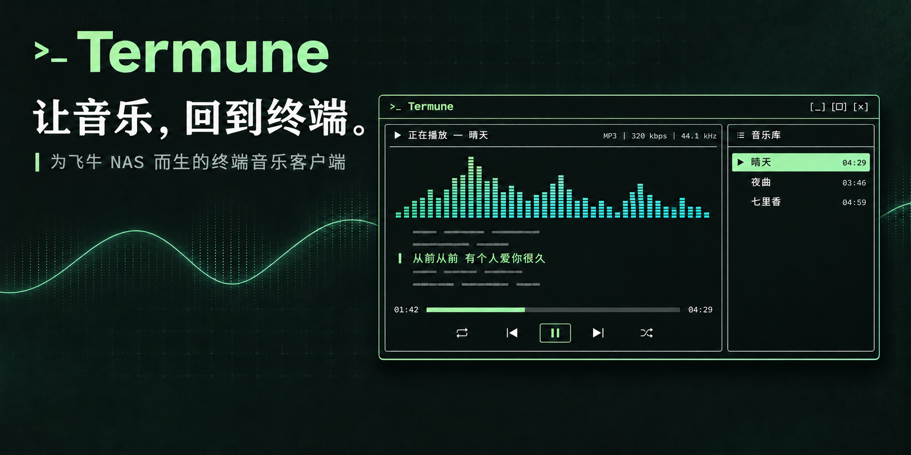

# Termune

[English](README.en.md) | [简体中文](README.md)

<p align="center">
  
</p>
<p align="center"><sub>Promotional concept artwork. Interface details may differ from the current version.</sub></p>

**Your NAS. Your music. Your terminal.**

A Rust terminal client for Feiniu Music. Enter your FN ID and separate Music account to browse, search and play music from your NAS.

This is an early release for Linux and macOS. Playback requires VLC. Termune is an unofficial third-party client and is not affiliated with or endorsed by Feiniu.

## Download

Get the `.tar.gz` for your platform from [GitHub Releases](https://github.com/Nyakooo/termune/releases/latest), extract it, and run `termune`. Archives include documentation and release notes. Verify downloads against `SHA256SUMS`. Extensionless binaries on the same page are for direct installation and self-updates.

| System | Architecture | Asset |
| --- | --- | --- |
| Linux | x86_64 | `termune-x86_64-unknown-linux-gnu.tar.gz` |
| Linux | ARM64 | `termune-aarch64-unknown-linux-gnu.tar.gz` |
| macOS | Intel | `termune-x86_64-apple-darwin.tar.gz` |
| macOS | Apple Silicon | `termune-aarch64-apple-darwin.tar.gz` |

Linux builds use GNU libc with Ubuntu 22.04 as the build baseline; Alpine/musl is not supported. macOS builds use macOS 15; older versions have not been verified. Linux x86_64 has local validation; other platforms rely on CI and still need real-device testing. Windows playback is not supported. Downloads become available once the first release workflow succeeds. Rust and Python are not needed to run release binaries.

## Setup and use

Install VLC and ensure `vlc` is on PATH. Debian/Ubuntu: `sudo apt install vlc`. On macOS, use `brew install --cask vlc`; add `/Applications/VLC.app/Contents/MacOS` to PATH if needed. Optional spectra require `ffmpeg` on PATH (`sudo apt install ffmpeg` or `brew install ffmpeg`). Analysis reads a separate audio stream and increases network traffic; minimal mode stops it.

Your NAS must be online with FN Connect enabled and Feiniu Music installed and initialized. Create a separate Music account first.

```sh
./termune
```

Enter your FN ID, Music username and hidden password. No full NAS URL is required. Official FN Connect discovery supplies routes; Termune probes local, public, DDNS and relay addresses with HTTPS certificate validation enabled. It does not implement browser JavaScript, WebRTC/P2P tunnels or FN Connect access codes.

Use a UTF-8 terminal with true color and mouse support, at least 36 × 20; 100 × 30 or larger is recommended. Browse tracks, albums, artists, playlists, genres and favorites. Lists load by page. Browsing elsewhere does not change the active playback source.

## Controls

| Action | Key |
| --- | --- |
| Select / play or open | ↑↓ / Enter |
| Six library sections | 1–6 / Alt+1–6, Tab / Shift+Tab |
| Page | ←→ / PageUp / PageDown |
| Search / refresh | /, R |
| Pause / stop | Space, S |
| Previous / next track | [ / ] |
| Seek | Click/drag timeline, Alt+←→ (5 seconds) |
| Sequence / loop all / repeat one / shuffle | O or click player mode |
| Favorite / details | F / I |
| Minimal / full | M, globally outside text input |
| Lyrics scrolling / resume following | Alt+↑↓ / Alt+Home |
| Help / settings | F1 / F2 |
| Back / quit | Esc / Q or Ctrl+C |

Settings manage theme, layout, language and account. Playback mode is in the player. LRC lyrics follow actual VLC position; plain text is manual. Spectra use decoded audio, stop on pause and restart after seeking. Independent decoding is approximately synchronized, not sample-accurate. Artwork is currently disabled.

## Update

```sh
termune update
```

Queries this repository's latest stable Release, downloads the matching binary, checks its SHA256, size and platform, and atomically replaces the current executable. Equal/newer versions are left alone; prereleases are excluded. Failed downloads or validation preserve the original program. Personal settings, NAS credentials and caches are untouched.

Use a writable installation directory such as `~/.local/bin`, add it to PATH, and close other Termune instances before updating. Restart after success. Standard `HTTPS_PROXY` / `NO_PROXY` environment variables apply to GitHub access. If an interrupted update leaves `.termune-update.lock`, ensure no updater is running before removing that file. Older versions without this command need one manual download first.

## Login and configuration

Opt into automatic login on the login form. Only the token and identity metadata are stored in the OS keystore, never the password. Startup discovers the current NAS route and validates `/user/me`; a valid session opens the library without showing the password form. Network failures preserve saved credentials; confirmed invalid sessions or identity mismatches clear them.

Linux needs a desktop Secret Service and user D-Bus session. macOS uses Keychain. If the keystore is unavailable, manual login still works but automatic login is not enabled. Disconnect through F2, then uncheck automatic login to disable it and delete saved credentials.

Preferences live in `~/.config/termune/config.toml` (or `$XDG_CONFIG_HOME`) on Linux, and `~/Library/Application Support/termune/config.toml` on macOS. They contain FN ID, username and UI/playback settings, not passwords or tokens. Do not commit personal configuration.

## Diagnostics

```sh
termune --version
termune --diagnose
termune --login-only
termune --help
```

Diagnostics sample library pages, search and media; success does not guarantee every track plays. Explicitly enabling `--allow-lan-http` on trusted local networks exposes password hashes/tokens to network interception; prefer HTTPS. Reports should omit passwords, tokens, cookies and raw network captures.

[Detailed usage (Chinese)](docs/USAGE.md) · [API notes](docs/FEINIU_API.md)

## Build and release

Use stable Rust with Rust 2024 support. Linux build dependencies: `pkg-config` and `libdbus-1-dev`.

```sh
cargo build --release --locked
cargo test --locked
cargo clippy --locked --all-targets -- -D warnings
```

[Actions](https://github.com/Nyakooo/termune/actions) runs format checks, Clippy, tests and native builds on four platforms. Pushing a `v*` tag matching Cargo.toml and Cargo.lock publishes archives, updater binaries and SHA256SUMS only after all platforms succeed. Prerelease tags are marked accordingly and skipped by the updater. See [RELEASING](docs/RELEASING.md).

UI and documentation organization are inspired by [Tunerift](https://github.com/Nyakooo/tunerift). Thanks to Ratatui, Crossterm, VLC and the Rust ecosystem.
