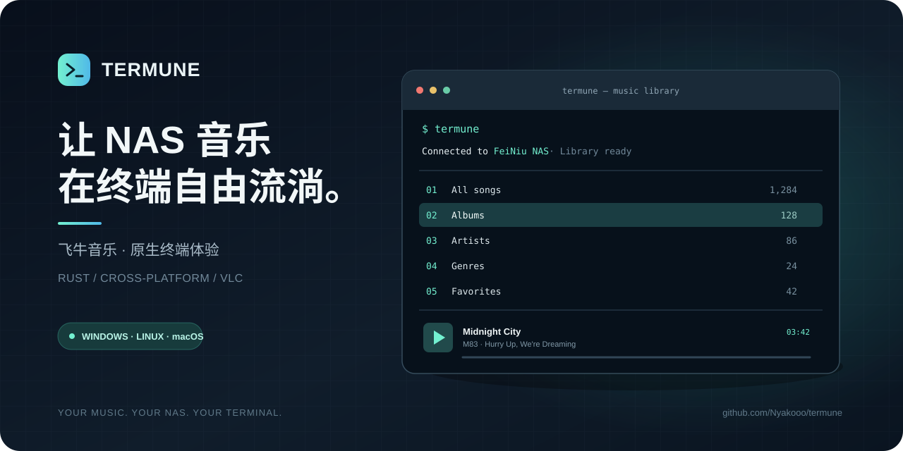
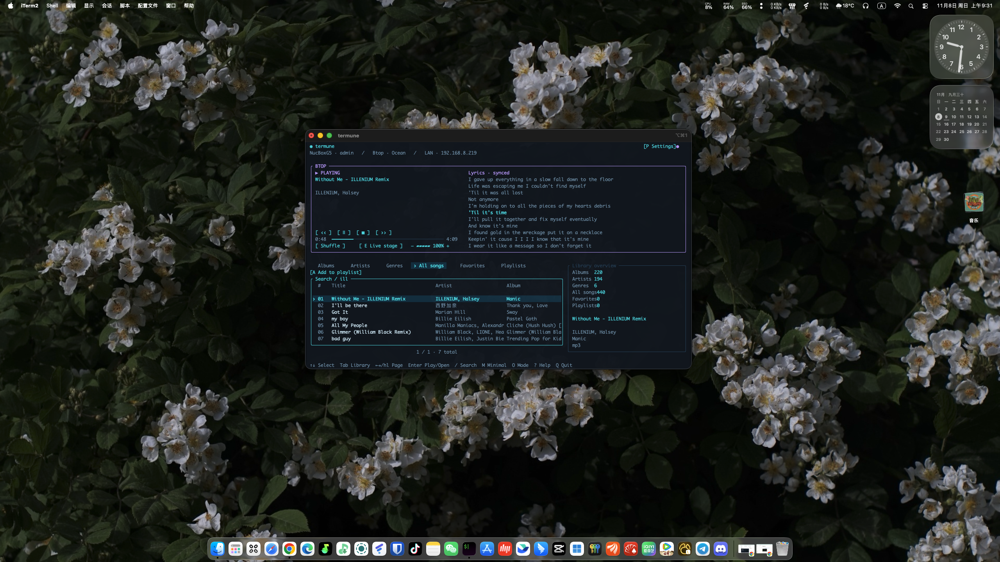
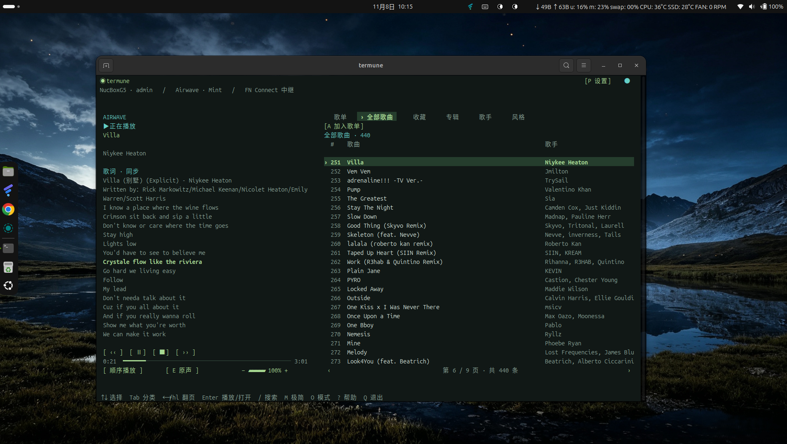
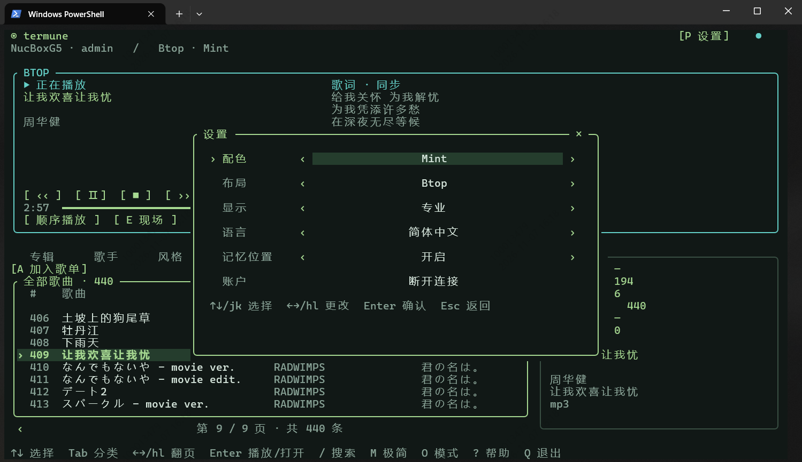

# Termune

[简体中文](README.md) | [English](README_EN.md)

**Termune 是一款面向飞牛 NAS 音乐的跨平台终端播放器。** 无需打开浏览器或桌面音乐客户端，在终端中即可连接自己的 NAS，浏览曲库、搜索歌曲、管理歌单并播放音乐。

## 多平台实际运行效果

Termune 已在 macOS、Linux 和 Windows 环境中实际运行。以下截图来自真实设备，并非模拟界面。

**macOS · Btop 布局**

**Linux · Airwave 布局**

**Windows · PowerShell · Btop 布局**

支持 **Windows、macOS 和 Linux**，使用 Rust 构建。Termune 是独立开发的第三方客户端，与飞牛官方没有隶属、合作或背书关系。

[下载最新版本](https://github.com/Nyakooo/termune/releases/latest) · [使用指南](docs/USAGE.md) · [反馈问题](https://github.com/Nyakooo/termune/issues)

---

## 功能一览

| 功能 | 说明 |
| --- | --- |
| NAS 连接 | 使用 FN ID 发现设备，自动探测可用连接线路 |
| 曲库浏览 | 浏览专辑、歌手、风格、全部歌曲、收藏和歌单 |
| 搜索 | 在曲库中快速查找歌曲 |
| 歌单管理 | 创建歌单、重命名、删除，以及添加或移除歌曲 |
| 播放控制 | 暂停、继续、停止、切歌、进度跳转和音量调节 |
| 播放模式 | 顺序播放、列表循环、单曲循环和随机播放 |
| 歌词 | 支持带时间戳歌词同步、手动浏览和歌词定位 |
| 音效 | 提供多种音效预设，可在播放过程中切换 |
| 多种界面 | 专业布局与极简模式，支持主题和中英文界面 |
| 自动登录 | 可将登录会话保存在系统凭据存储中 |
| 记忆位置 | 记住上次浏览的分类、页面和选中位置 |
| 自更新 | 在终端中检查并安装最新正式版本 |

## 界面与体验

Termune 提供完整的交互式终端界面，支持键盘和鼠标操作：

- **多种专业布局**：Airwave、Operations、Tracker 和 Btop。
- **极简模式**：保留曲库与基本播放控制，减少界面信息。
- **个性化设置**：切换主题、语言、布局和显示模式。
- **播放队列**：队列保持开始播放时的来源，浏览其他分类不会打断当前播放。
- **歌词同步**：带时间戳的歌词跟随播放进度，也可以手动浏览或双击歌词跳转。
- **音效预设**：可在播放过程中切换不同听感。

## 安装

### 一键安装

Linux / macOS：

    curl -fsSL https://raw.githubusercontent.com/Nyakooo/termune/master/install.sh | sh

Windows（PowerShell 5.1 或 PowerShell 7）：

    irm https://raw.githubusercontent.com/Nyakooo/termune/master/install.ps1 | iex

安装脚本会自动识别操作系统和 CPU 架构，下载最新正式版并校验 SHA256。无需安装 Rust、Python，也不需要管理员权限。再次运行相同命令即可更新。

安装完成后重新打开终端，运行：

    termune

### 手动下载

前往 [GitHub Releases](https://github.com/Nyakooo/termune/releases/latest)，根据系统和架构下载对应资源包。

| 系统 | 架构 | 发布包 |
| --- | --- | --- |
| Windows | x86_64 | ZIP |
| Windows | ARM64 | ZIP |
| macOS | Intel | TAR.GZ |
| macOS | Apple Silicon | TAR.GZ |
| Linux | x86_64 | TAR.GZ |
| Linux | ARM64 | TAR.GZ |

解压后运行目录中的 termune.exe（Windows）或 ./termune（Linux / macOS）。

## 开始使用

### NAS 端准备

1. 确保飞牛 NAS 正常在线，并启用 FN Connect。
2. 在 NAS 上安装并初始化飞牛音乐。
3. 创建一个飞牛音乐的**音乐独立账号**，用于 Termune 登录。

### 首次登录

运行 termune，按照提示输入：

- **FN ID**：用于发现你的 NAS 设备。
- **音乐用户名**：飞牛音乐的独立账号。
- **音乐密码**：对应账号的密码。

FN ID 只用于设备发现，不代替音乐账号认证。密码输入时不会明文显示。

登录页可以勾选「下次自动登录」。登录成功后，Termune 会将会话凭据保存到系统凭据存储；不会把音乐密码写入普通配置文件。

### 连接方式

Termune 会根据 FN ID 获取候选连接地址，并自动探测可用线路。连接成功后，界面顶栏会显示当前连接方式及相关地址信息。局域网、公网和中继线路的实际可用性取决于 NAS 网络环境。

## 快捷键速查

Termune 支持键盘和鼠标交互。以下是曲库界面的快捷键速查；登录页、搜索框、弹窗和设置页还提供各自的上下文操作提示。

### 曲库导航

| 快捷键 | 操作 |
| --- | --- |
| ↑ / ↓、j / k | 上下选择条目 |
| Home / End | 跳到当前页首 / 尾 |
| Enter | 打开分类、详情或播放选中歌曲 |
| Tab / Shift+Tab | 切换曲库分类 |
| 1～6 | 直接切换六种曲库分类 |
| Alt+1～Alt+6 | 快速切换曲库分类 |
| Alt+← / →、Alt+h / Alt+l | 调整分类顺序 |
| ← / →、h / l | 上一页 / 下一页 |
| PageUp / PageDown | 上一页 / 下一页 |
| R | 刷新当前页面 |
| Esc | 返回上一级或取消当前操作 |

六种分类依次为：专辑、歌手、风格、全部歌曲、收藏和歌单。

### 搜索与歌单

| 快捷键 | 操作 |
| --- | --- |
| / | 打开搜索 |
| Enter | 确认搜索 |
| Esc | 取消搜索或返回搜索结果列表 |
| Ctrl+U | 清空当前输入内容 |
| F | 收藏 / 取消收藏选中歌曲 |
| A | 将选中歌曲加入歌单 |
| N | 在歌单分类中新建歌单 |
| C | 重命名选中歌单 |
| D / Delete | 删除歌单，或从当前歌单移除歌曲（需要确认） |

### 播放控制

| 快捷键 | 操作 |
| --- | --- |
| Space | 暂停 / 继续播放 |
| S | 停止播放 |
| [ / ] | 上一首 / 下一首 |
| Ctrl+← / Ctrl+→ | 快退 / 快进 5 秒 |
| Ctrl+h / Ctrl+l | 快退 / 快进 5 秒 |
| - | 降低音量 |
| + / = | 提高音量 |
| O | 切换播放模式 |
| E | 切换到下一种音效 |
| Shift+E | 切换到上一种音效 |

播放模式包括顺序播放、列表循环、单曲循环和随机播放。进度条支持鼠标点击或拖动；音量和播放器模式也可以直接通过界面操作。

### 界面、歌词与设置

| 快捷键 | 操作 |
| --- | --- |
| M | 切换专业 / 极简模式 |
| P | 打开设置 |
| ↑ / ↓、j / k | 在设置中选择选项 |
| ← / →、h / l | 修改当前设置项 |
| Enter | 确认设置 |
| Esc | 返回 / 关闭设置 |
| Alt+↑ / Alt+↓ | 手动浏览歌词 |
| Alt+Home | 恢复歌词自动跟随 |
| ? / F1 | 打开快捷键帮助 |
| Q | 退出程序 |
| Ctrl+C | 退出程序 |

> 不同页面的按键行为可能随当前焦点和输入状态变化。例如正在输入搜索内容或密码时，文字按键不会触发曲库快捷操作。按 ? 可在程序内查看帮助。

## 更新

已安装的 Termune 可以直接在终端执行：

    termune update

程序会检查最新正式 Release，按当前系统和架构下载对应版本，并在替换前验证 SHA256。更新不会修改登录凭据、个人配置和缓存。

## 运行环境与兼容性

- 支持 Windows、macOS 和 Linux，提供 x86_64 与 ARM64 发布包。
- Linux 构建以 Ubuntu 22.04 为基线，使用 GNU libc；不提供 Alpine / musl 版本。
- macOS 使用原生构建，旧版本 macOS 的兼容性尚未全部验证。
- 建议终端尺寸至少为 **36 × 20**，推荐 **100 × 30** 或更大；建议使用支持 UTF-8、真彩色和鼠标事件的终端。
- Termune 需要 NAS 在线、飞牛音乐已初始化，并使用音乐独立账号登录。

## 诊断与问题反馈

遇到连接或播放问题时，可以先运行：

    termune --version
    termune --login-only
    termune --diagnose

| 命令 | 用途 |
| --- | --- |
| termune --version | 查看当前版本 |
| termune --login-only | 检查设备发现、连接线路和账号登录 |
| termune --diagnose | 抽样检查连接、登录、曲库、搜索和媒体资源 |
| termune --help | 查看命令行帮助 |

提交问题时请附上 Termune 版本、操作系统、复现步骤和脱敏诊断结果。**请勿提交音乐密码、会话令牌、Cookie 或完整网络抓包。**

- [GitHub Issues](https://github.com/Nyakooo/termune/issues)
- [详细使用指南](docs/USAGE.md)
- [飞牛连接与兼容性](docs/FEINIU_API.md)
- [更新记录](RELEASE_NOTES.md)
- [音效说明](docs/AUDIO_EFFECTS.md) · [音频组件许可](docs/AUDIO_LICENSES.md)

## 免责声明

Termune 是独立开发的第三方开源客户端，仅用于连接用户自己的飞牛 NAS 音乐服务。Termune 与飞牛官方没有隶属、合作或背书关系。请遵守所在地法律法规及飞牛音乐服务的使用条款。

## 许可证

本项目采用 [MIT License](LICENSE)。
