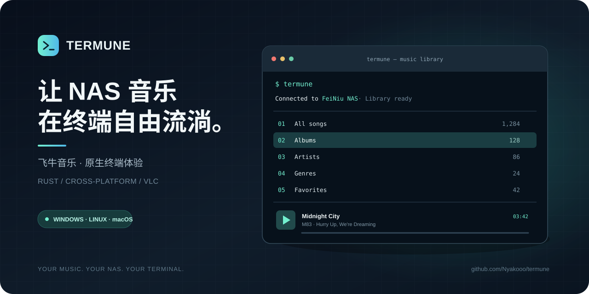
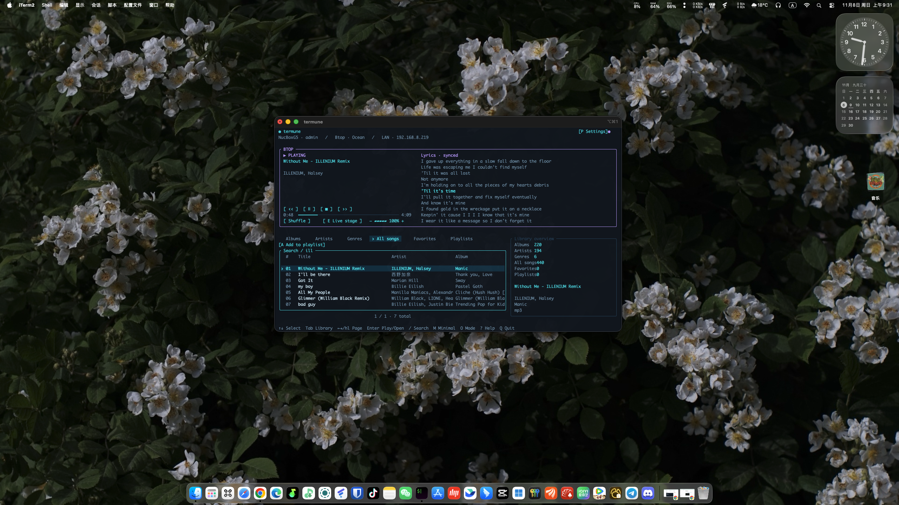

# Termune

[简体中文](README.md) | **English**



**Termune is a cross-platform terminal music player for Feiniu NAS.** Connect to your NAS from the terminal to browse your music library, search tracks, manage playlists, and play music — without opening a browser or a desktop music app.

<p align="center">
  
</p>

Runs on **Windows, macOS, and Linux**, and is built with Rust. Termune is an independent third-party client and is not affiliated with, endorsed by, or officially supported by Feiniu.

[Download latest release](https://github.com/Nyakooo/termune/releases/latest) · [User guide](docs/USAGE.md) · [Report an issue](https://github.com/Nyakooo/termune/issues)

---

## Features

| Feature | Description |
| --- | --- |
| NAS connection | Discover your device with FN ID and automatically probe available routes |
| Library browsing | Browse albums, artists, genres, all songs, favorites, and playlists |
| Search | Quickly find tracks in your music library |
| Playlist management | Create, rename, and delete playlists; add or remove tracks |
| Playback controls | Play, pause, stop, skip tracks, seek, and adjust volume |
| Playback modes | Sequential, repeat all, repeat one, and shuffle |
| Lyrics | Synchronized timestamped lyrics, manual browsing, and lyric seeking |
| Audio effects | Multiple built-in sound presets, switchable during playback |
| Multiple layouts | Professional layouts and a minimal mode, with themes and localization |
| Automatic login | Store session credentials in the operating system credential store |
| Remember position | Restore the previous library category, page, and selection |
| Self-update | Check for and install the latest stable release from the terminal |

## Interface

Termune provides an interactive terminal UI with both keyboard and mouse support.

- **Four professional layouts**: Airwave, Operations, Tracker, and Btop.
- **Minimal mode**: Keep the library and essential playback controls in a compact view.
- **Personalization**: Choose themes, language, layout, and display preferences.
- **Playback queue**: The queue retains its original source while you browse other library sections.
- **Synchronized lyrics**: Timestamped lyrics follow playback. You can browse manually or jump to a line.
- **Audio presets**: Switch sound profiles while a track is playing.

## Installation

### Quick install

Linux / macOS:

```sh
curl -fsSL https://raw.githubusercontent.com/Nyakooo/termune/master/install.sh | sh
```

Windows (PowerShell 5.1 or PowerShell 7):

```powershell
irm https://raw.githubusercontent.com/Nyakooo/termune/master/install.ps1 | iex
```

The installer detects your operating system and CPU architecture, downloads the latest stable release, and verifies its SHA256 checksum. Rust and Python are not required, and administrator privileges are not needed for the default user-level installation. Run the same command again to update.

Open a new terminal and run:

```sh
termune
```

### Manual download

Visit [GitHub Releases](https://github.com/Nyakooo/termune/releases/latest) and download the package for your operating system and architecture.

| Operating system | Architecture | Package |
| --- | --- | --- |
| Windows | x86_64 | ZIP |
| Windows | ARM64 | ZIP |
| macOS | Intel | TAR.GZ |
| macOS | Apple Silicon | TAR.GZ |
| Linux | x86_64 | TAR.GZ |
| Linux | ARM64 | TAR.GZ |

Extract the archive and run `termune.exe` on Windows or `./termune` on Linux / macOS.

## Getting started

### Prepare your NAS

1. Make sure your Feiniu NAS is online and FN Connect is enabled.
2. Install and initialize Feiniu Music on the NAS.
3. Create a **Feiniu Music independent account** for Termune.

### First login

Run:

```sh
termune
```

Enter the following when prompted:

- **FN ID**: Used to discover your NAS.
- **Music username**: The independent account created in Feiniu Music.
- **Music password**: The password for that account.

FN ID is only used for device discovery; it is not your music account and cannot replace music account authentication. Password input is hidden.

You can enable **Remember me** on the login screen. After a successful login, Termune stores the session credential in the operating system credential store. Your music password is not saved in the regular configuration file.

### Connection routes

Termune retrieves candidate addresses for your FN ID and probes available routes automatically. The current connection type and related address are shown in the top bar after connecting. Actual LAN, public, and relay availability depends on your NAS and network environment.

## Keyboard shortcuts

Termune supports both keyboard and mouse interaction. The following shortcuts apply to the library view. Login, search, dialogs, and settings also provide context-specific actions.

### Library navigation

| Shortcut | Action |
| --- | --- |
| `↑` / `↓`, `k` / `j` | Move selection up / down |
| `Home` / `End` | Jump to the first / last item on the current page |
| `Enter` | Open a category or detail, or play the selected track |
| `Tab` / `Shift+Tab` | Switch library categories |
| `1`–`6` | Switch directly to one of the six library categories |
| `Alt+1`–`Alt+6` | Quickly switch library categories |
| `Alt+←` / `Alt+→`, `Alt+h` / `Alt+l` | Reorder library categories |
| `←` / `→`, `h` / `l` | Previous / next page |
| `PageUp` / `PageDown` | Previous / next page |
| `R` | Refresh the current page |
| `Esc` | Go back or cancel the current action |

The six categories are Albums, Artists, Genres, All Songs, Favorites, and Playlists.

### Search and playlists

| Shortcut | Action |
| --- | --- |
| `/` | Open search |
| `Enter` | Submit search |
| `Esc` | Cancel search or return to the results list |
| `Ctrl+U` | Clear the current input |
| `F` | Add / remove the selected track from Favorites |
| `A` | Add the selected track to a playlist |
| `N` | Create a playlist in the Playlists category |
| `C` | Rename the selected playlist |
| `D` / `Delete` | Delete a playlist or remove a track from the current playlist (confirmation required) |

### Playback

| Shortcut | Action |
| --- | --- |
| `Space` | Pause / resume |
| `S` | Stop playback |
| `[` / `]` | Previous / next track |
| `Ctrl+←` / `Ctrl+→` | Seek backward / forward by 5 seconds |
| `Ctrl+h` / `Ctrl+l` | Seek backward / forward by 5 seconds |
| `-` | Decrease volume |
| `+` / `=` | Increase volume |
| `O` | Switch playback mode |
| `E` | Next audio preset |
| `Shift+E` | Previous audio preset |

Playback modes include sequential, repeat all, repeat one, and shuffle. You can also click or drag the progress bar and adjust volume from the player UI.

### Interface, lyrics, and settings

| Shortcut | Action |
| --- | --- |
| `M` | Switch between professional and minimal modes |
| `P` | Open settings |
| `↑` / `↓`, `j` / `k` | Select an option in settings |
| `←` / `→`, `h` / `l` | Change the selected setting |
| `Enter` | Confirm a setting |
| `Esc` | Go back / close settings |
| `Alt+↑` / `Alt+↓` | Browse lyrics manually |
| `Alt+Home` | Resume automatic lyric following |
| `?` / `F1` | Open keyboard shortcut help |
| `Q` | Quit |
| `Ctrl+C` | Quit |

> Key behavior can depend on the current page and input focus. For example, while entering search text or a password, character keys are treated as input rather than library shortcuts. Press `?` in the app to view shortcut help.

## Updating

Update an installed copy directly from the terminal:

```sh
termune update
```

Termune checks the latest stable release, downloads the package for the current operating system and architecture, and verifies its SHA256 checksum before replacing the executable. Your login credentials, personal settings, and cache are preserved.

## Requirements and compatibility

- Windows, macOS, and Linux are supported, with x86_64 and ARM64 release packages.
- Linux builds target Ubuntu 22.04 as the baseline and use GNU libc. Alpine / musl builds are not provided.
- macOS builds are native; compatibility with older macOS versions has not been fully verified.
- Recommended terminal size: at least **36 × 20**, preferably **100 × 30** or larger. A terminal with UTF-8, true-color, and mouse-event support is recommended.
- Your NAS must be online, Feiniu Music must be initialized, and you must have a valid independent music account.

## Diagnostics and support

If you encounter connection or playback issues, start with:

```sh
termune --version
termune --login-only
termune --diagnose
```

| Command | Purpose |
| --- | --- |
| `termune --version` | Show the installed version |
| `termune --login-only` | Check device discovery, connection routes, and account login |
| `termune --diagnose` | Check connectivity, login, library, search, and media resources |
| `termune --help` | Show command-line help |

When reporting an issue, include your Termune version, operating system, reproduction steps, and a redacted diagnostic report. **Never share your music password, session token, cookies, signed URLs, or a full network capture.**

- [GitHub Issues](https://github.com/Nyakooo/termune/issues)
- [Detailed user guide](docs/USAGE.md)
- [Feiniu connection and compatibility](docs/FEINIU_API.md)
- [Audio effects](docs/AUDIO_EFFECTS.md)
- [Release notes](RELEASE_NOTES.md)
- [Audio component licenses](docs/AUDIO_LICENSES.md)

## Disclaimer

Termune is an independently developed third-party client for accessing your own Feiniu NAS music service. It is not affiliated with, sponsored by, or endorsed by Feiniu. Please comply with applicable laws and the terms of service of Feiniu Music.

## License

This project is licensed under the [MIT License](LICENSE).
